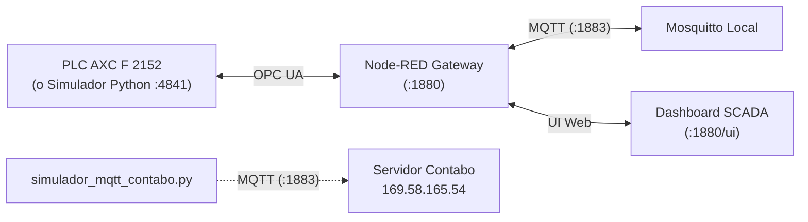

# Proyecto de Automatización Industrial — PLCnext AXC F 2152 + OPC UA + Node-RED + MQTT

Documentación principal del proyecto ubicado en `C:\Users\Albert\Desktop\PLC2 entrega 2`. Explica **qué archivos existen** y **cómo funciona el flujo completo** de supervisión y control.

---

## 1. ¿Qué hay en el proyecto? (Inventario real)

```text
PLC2 entrega 2/
├── App1.plcnx2                         # Proyecto base para PLCnext Engineer 2026.6 (AXC F 2152)
├── README.md                           # Este documento (explicación general y del flujo)
├── README_GUIA_NODE_RED_PLC.md         # Guía técnica de instalación, protocolos y puesta en marcha
├── plcnext_st/                         # Código IEC 61131-3 Structured Text (ST) listo para PLCnext
│   ├── PRG_Main.st                     # Programa coordinador y variables compartidas con OPC UA
│   ├── PRG_Inputs.st                   # Lectura de pulsadores Start/Stop, antirrebote y flancos
│   ├── PRG_Analog.st                   # Lectura 0-10 V, escalamiento %, filtro EMA y rango válido
│   ├── PRG_Communication.st            # Heartbeats (PLC/Gateway) y Watchdog de comunicación
│   ├── PRG_Alarms.st                   # Gestión centralizada de alarmas y reset controlado
│   └── PRG_Motor.st                    # Control de motor con prioridad de parada física e interlocks
├── node-red/
│   └── flow_plcnext_scada.json         # Flujo importable en Node-RED (OPC UA + MQTT + SCADA)
├── simulador_plc/
│   ├── simulador_axcf2152.py           # Simulador Python OPC UA local (opc.tcp://127.0.0.1:4841)
│   └── simulador_mqtt_contabo.py       # Simulador Python -> MQTT Contabo (169.58.165.54:1883)
├── docs/
│   └── TABLA_MAESTRA_TAGS.md           # Tabla maestra de variables (Tags), tipos y permisos OPC UA
└── scripts/
    └── verificar_entorno.ps1           # Script PowerShell de diagnóstico de red, puertos y servicios
```

---

## 2. ¿Cómo funciona el flujo general?

El sistema implementa **comunicación bidireccional** manteniendo la autoridad de seguridad siempre en el PLC:



- **Flujo de Supervisión (Lectura):**  
  `PLC / Simulador` → **OPC UA** → `Node-RED` (normaliza a JSON) → **MQTT** (`plcnext/axcf2152/telemetry`) → `Dashboard SCADA` (`/ui`).
- **Flujo de Control (Escritura con confirmación real):**  
  `Dashboard SCADA` (botón) → **MQTT** (`plcnext/axcf2152/cmd/#`, QoS 1) → `Node-RED` (valida `cmd_id` único, expiración `ttl_ms` y permisos) → **OPC UA** (`CMD_*`) → `PLC` → **ACK real** (`plcnext/axcf2152/ack`) → `Dashboard`.

---

## 3. Explicación del Flujo de Node-RED (`node-red/flow_plcnext_scada.json`)

El flujo está dividido en **3 pestañas**:

1. **`1. OPC UA & Procesamiento`**
   - Dispara un ciclo cada **1 segundo** (`Ciclo Lectura + HB`).
   - Lee las 15 variables del PLC (`DI_*`, `AI_*`, `DO_*`, `SYS_*`, `DIAG_Last_Error`) vía **OPC UA**.
   - Incrementa y escribe `SYS_Gateway_Heartbeat` hacia el PLC para alimentar su *watchdog*.
   - Normaliza los datos al formato JSON estándar (`device`, `timestamp`, `sensor`, `inputs`, `outputs`, `system`).
   - Captura errores OPC UA y los publica como alarma (`plcnext/axcf2152/alarms`).

2. **`2. MQTT & Control Remoto`**
   - **Buffer Offline:** si Mosquitto se desconecta, guarda hasta 100 mensajes de telemetría en memoria y los envía en orden al reconectar.
   - **Validación de Comandos (`plcnext/axcf2152/cmd/#`, QoS 1):**
     - Rechaza mensajes sin `cmd_id`.
     - Evita duplicados guardando los últimos 100 `cmd_id`.
     - Verifica caducidad (`ttl_ms`, 10 s por defecto) y que no exista alarma activa (`SYS_Alarm`) antes de arrancar.
     - Escribe en OPC UA (`CMD_Motor_Start`, `CMD_Motor_Stop`, `CMD_LED`, `CMD_Reset_Alarm`) y publica el `ack` real en `plcnext/axcf2152/ack`.

3. **`3. Dashboard SCADA` (`http://localhost:1880/ui`)**
   - **Panel Principal:** Estado de PLC/OPC UA, Broker MQTT, Motor y Alarma.
   - **Panel de Variables:** Gauges de Voltaje (`0–10 V`), Porcentaje (`0–100 %`), entradas digitales y Heartbeats.
   - **Panel de Control:** Botones de Arranque, Parada, LED y Reset de Alarma. El estado solo se confirma cuando llega el `ack` real del PLC.
   - **Panel de Gráficas y Eventos:** Tendencias en tiempo real de voltaje, porcentaje y estado del motor (`0/1`).

---

## 4. Cómo ejecutar cada parte

1. **Simulador PLC OPC UA local** (puerto `4841`, evita conflicto con `opcualds` en `4840`):
   ```powershell
   python "C:\Users\Albert\Desktop\PLC2 entrega 2\simulador_plc\simulador_axcf2152.py"
   ```
2. **Node-RED** (`http://localhost:1880` y `http://localhost:1880/ui`):
   ```powershell
   node-red
   ```
3. **Mosquitto local** (requiere usuario/contraseña de `C:\Program Files\mosquitto\passwd`):
   ```powershell
   & "C:\Program Files\mosquitto\mosquitto.exe" -c "C:\Program Files\mosquitto\mosquitto.conf"
   ```
4. **Simulador hacia el servidor Contabo (`169.58.165.54`):**
   ```powershell
   python "C:\Users\Albert\Desktop\PLC2 entrega 2\simulador_plc\simulador_mqtt_contabo.py" --user TU_USUARIO_MQTT --password TU_PASSWORD_MQTT
   ```
